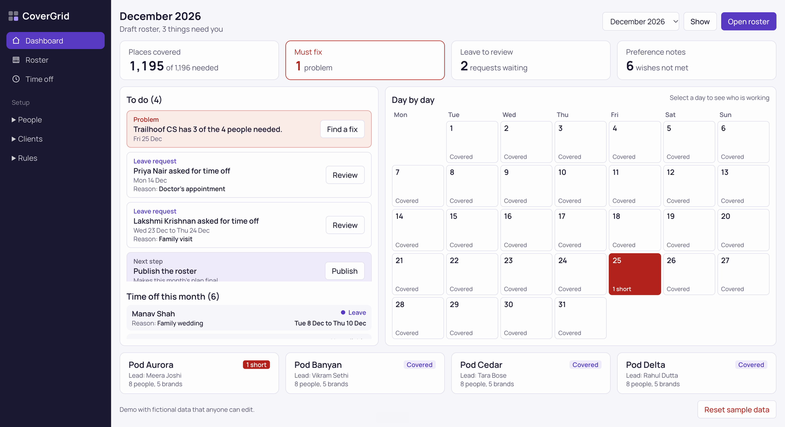
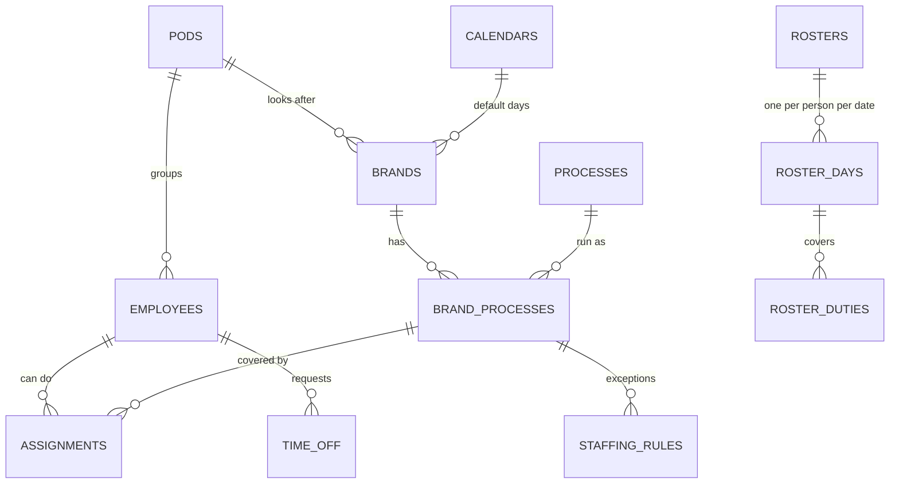
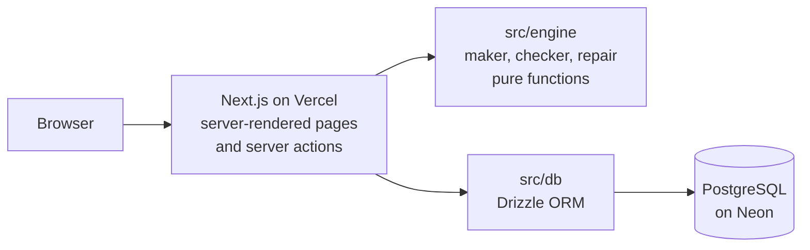
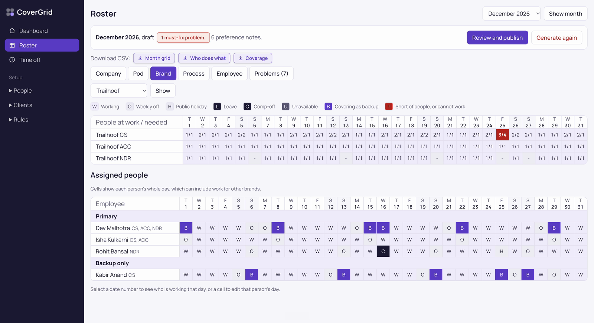
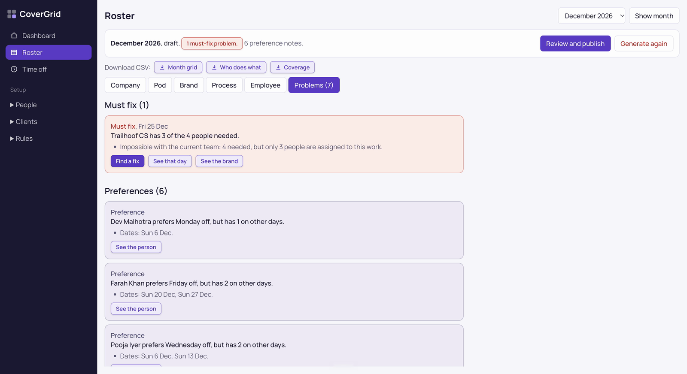
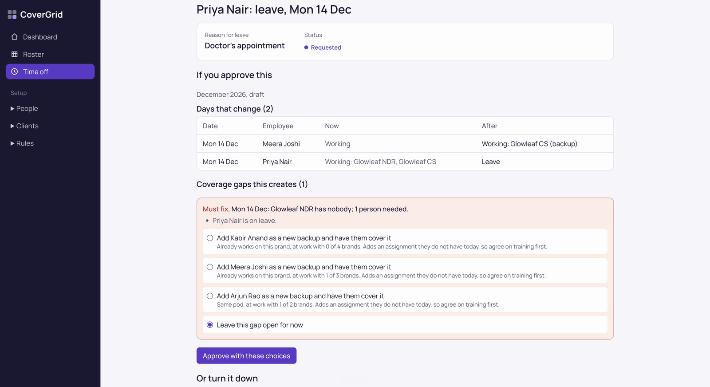

# CoverGrid: Smart Roster Management System

**Plan, generate, check and change monthly rosters across brands, processes and pods, with
every coverage gap shown and explained.**

[](https://nextjs.org/)
[](https://react.dev/)
[](https://www.typescriptlang.org/)
[](https://neon.com/)
[](https://vercel.com/)

| | |
|---|---|
| **Live app** | https://covergrid.vercel.app |
| **Demo video** (about 3.5 minutes) | https://youtu.be/PQ1vGBkMeLY |
| **Sample month** | December 2026 |

No login is needed. All data is fictional and anyone can edit it. **Reset sample data**, at
the bottom of the Dashboard, restores the starting state. Please do not enter real personal
data.

**Try it in two minutes:** open the Dashboard, generate the December 2026 roster, open
**Problems**, then **Review** Priya Nair's leave request.



## Contents

- [How I think: the eight questions](#how-i-think-the-eight-questions)
- [Approach and architecture](#approach-and-architecture)
- [What it does](#what-it-does)
- [Screenshots](#screenshots)
- [Sample data](#sample-data)
- [Assumptions](#assumptions)
- [Tech stack](#tech-stack)
- [Run it locally](#run-it-locally)
- [Testing](#testing)
- [Project structure](#project-structure)
- [Security](#security)
- [Limitations](#limitations)
- [How it was built](#how-it-was-built)

---

## How I think: the eight questions

### 1. How did you model employees, brands, processes, pods and their relationships?



- A **pod** has a lead. An **employee** belongs to one pod and has their own weekly-off
  count, fixed off days, days they cannot work, preferred off days and a limit on brands
  per day.
- A **brand** belongs to a pod and has a default **operating calendar**.
- A **brand process** (`services` in the code) is one process for one brand, for example
  "Glowleaf NDR". It is the unit that needs coverage. It has a shift, a minimum number of
  people and, optionally, its own calendar.
- An **assignment** links an employee to a brand process as **primary** or **backup**.
- **Staffing rules** override the minimum for a weekday or an exact date.
- **Time off** (leave, comp-off, unavailable) has a status; only approved entries count.
- A **roster** is one month: one row per person per date, plus the duties covered.

This keeps the brand's calendar (when work must happen) separate from the person's schedule
(when they work). Schema: [src/db/schema.ts](src/db/schema.ts).

### 2. How does your system generate a roster and decide whether it satisfies the constraints?

1. Work out the need of every brand process on every date. The most specific rule wins: a
   date rule, then the calendar, then a weekday rule, then the normal minimum.
2. Block the days people cannot work (approved time off and unavailable weekdays).
3. Choose weekly offs. Each person starts with their own best days, then the choice is
   improved one change or one two-person swap at a time until nothing helps. An uncovered
   place costs far more than any preference, so client coverage comes first. Long working
   stretches and unfairly shared missed preferences also cost points.
4. For each day, an exact search decides who covers what: fewest gaps first, then fewest
   backups. One person works one shift and a limited number of brands.

People who share no work cannot affect each other, so each connected group is planned
separately, which keeps it fast. Whole Monday-to-Sunday weeks are planned, and the previous
month's roster is counted for the shared week.

A separate **checker** then tests the result from scratch.

| Must-fix (blocks normal publishing) | Preference (allowed, but shown) |
|---|---|
| Gaps and under-staffing | Preferred off day missed |
| Working while on leave or on a blocked day | More than 7 days in a row |
| Shift clash, or too many brands in a day | More weekly offs than agreed |
| Covering work without an assignment | Covering a process that is closed |
| Too few weekly offs, or an unearned comp-off | Day status that differs from the records |

Code: [generate.ts](src/engine/generate.ts), [cover-day.ts](src/engine/cover-day.ts),
[check.ts](src/engine/check.ts).

### 3. How did you handle the difference between single-resource brands and brands with multiple employees?

Both use the same model, so the code has no special case. The difference is in the
assignments. A one-person brand has one primary, usually with the pod's floater and lead as
approved backups (Glowleaf NDR deliberately has none). A shared brand has several
primaries across its processes (sometimes two on the same one), often backing each other
up. The daily search uses primaries first and backups only when needed, and prefers one
backup for a whole brand.

### 4. What happens when an employee manages all processes for a brand but is unavailable on a required working day?

Reviewing the leave request shows the effect **before anything is saved**:

- processes with an approved backup are covered, and the preview names the person;
- processes without one are flagged as a gap, with the reason;
- for each gap the app lists checked options: an assigned person who is at work, a
  weekly-off swap inside the same week, or, only if no assigned person can help, adding a
  pod colleague as a new backup (labelled as needing training);
- for a pending request, nearby dates that would cause no new problem are suggested when
  there are any.

The manager can approve with a fix, approve and leave the gap flagged, or reject. Only the
affected days change; the rest of the month stays as it was.

In the sample data, Priya Nair's request for 14 December shows this. Lakshmi Krishnan's
request shows the shared-brand case, where a colleague absorbs the work.

### 5. How does your system handle conflicting requirements or insufficient staffing?

Mandatory rules are never traded away: approved leave, fixed offs, weekly-off counts, shift
limits and brand limits. Client coverage ranks above preferences. If demand still cannot be
met, the gap stays visible with the reason for each assigned person, and says "impossible
with the current team" when fewer people know the work than are needed. Publishing is then
blocked unless the manager writes why, and that reason is kept with the roster.

The sample data includes one impossible requirement on purpose: Trailhoof Customer Support
needs 4 people on 25 December, but only 3 know the work.

### 6. Which parts of the process did you automate, and which did you leave under human control? Why?

| Automated | Left to the manager |
|---|---|
| Building the month and daily cover | Approving or rejecting leave |
| Finding and explaining problems | Choosing a fix |
| Previewing the effect of a change | Adding a new backup |
| Suggesting checked fixes | Editing a day |
| Repairing only the affected days | Publishing, and giving a reason to override |
| Crediting comp-offs for published holiday work | |

The manager's choices affect people and clients, and depend on things the data does not
know: is this person really trained, has the client agreed. A day edited by hand is locked,
so repair does not overwrite that decision unless the person cannot work.

### 7. If the company doubled its team and brand count, what would you change?

- Planning cost grows with the size of each connected group more than with the total, so I
  would measure large groups first. If they became slow or the result poor, I would move
  generation to a background job and use a constraint solver such as OR-Tools CP-SAT.
- Load only the time off and history a month needs, instead of whole tables.
- Send less to the browser: the company grid would need filtering or virtual rows, and the
  data lists would need pages.
- Add logins and roles, so pod leads manage their own pods, and stop two people from
  overwriting each other's saves.

### 8. If you had one additional week, what would you improve first?

1. Logins, roles and a pod-lead approval step.
2. Protection against two managers saving at once.
3. The plain edit form for time off, which can still approve without the preview.
4. Shifts that pass midnight.
5. Comp-offs based on attendance rather than the plan, and notifications when a published
   roster changes.

---

## Approach and architecture

The hard part is not drawing a calendar. It is deciding who covers what, and saying clearly
when that is impossible. So the scheduling logic is plain TypeScript with no database or
framework in it, and it has two independent halves:

- a **maker** that plans weekly offs and daily cover, and
- a **checker** that tests any roster, generated or edited by hand, against every rule.

The checker shares only the date and demand facts with the maker, never its decisions, so a
mistake in the maker cannot hide itself.



**Key decisions**

| Decision | Why | Trade-off |
|---|---|---|
| Own scheduling logic, not an AI model or a solver library | Repeatable, testable and explainable | The weekly-off choice is not proven optimal |
| Coverage is needed per brand + process | One brand's processes can differ in days, shift and staffing | More data to set up |
| A change is previewed, then saved | The manager sees the damage and the options first | One extra step |
| Gaps are shown, never papered over | Rest days and leave are never silently cancelled | The manager has to act |
| No login | Reviewers can test everything at once | Not suitable for real data |

## What it does

| Requirement | In CoverGrid |
|---|---|
| Team, brand and process management | Add, edit and delete employees, pods, brands, processes and assignments from the side menu |
| Client-specific working rules | Operating calendars, shifts, holidays and staffing rules per weekday or date |
| Monthly roster generation | Choose a month and generate it from calendars, assignments, time off and preferences |
| Conflict detection | Must-fix problems and preferences, each with its reason |
| Views | Company, pod, brand, process, employee and single-day views |
| Editing | Edit one person's day and see the effect before saving |
| Handling changes | Leave review with a preview and fixes; repair of affected days when other data changes |
| Publishing | Checked on the server; a written reason is needed if problems are open |
| Export | CSV month grid, who does what, and coverage by day |

Optional features included: fairer sharing of missed preferences, preference-based
scheduling, repair after approved changes, backup recommendations, CSV export, and adding
brands, pods and processes without code changes.

## Screenshots

| Brand coverage, with the 25 December shortfall | Problems, with reasons |
|---|---|
|  |  |



## Sample data

32 employees in 4 pods and 20 brands. 16 brands (80%) have one person doing all their
processes; the other 4 have two or three, including processes shared by two people. There
are three operating calendars (365 days; public holidays off; Sundays and public holidays
off), three shifts, staffing rules, and approved and pending time off. All names are
invented. Source: [src/seed/data.ts](src/seed/data.ts).

## Assumptions

- A week runs Monday to Sunday, and weekly offs are counted per week.
- One shift per person per day, and a shift starts and ends on the same day.
- Minimum staffing counts people, not hours.
- A backup is someone already able to do the work.
- A public holiday applies to everyone; each calendar decides whether it is open.
- Working a public holiday earns one comp-off, credited when the roster is published.

## Tech stack

| Layer | Tools |
|---|---|
| App | Next.js 16, React 19, TypeScript |
| Styling | Tailwind CSS 4, design notes in [DESIGN.md](DESIGN.md) |
| Data | PostgreSQL on Neon, Drizzle ORM and migrations |
| Validation | Zod, server-side |
| Quality | Vitest, ESLint, TypeScript type checks |
| Hosting | Vercel (deploys the `main` branch) |

## Run it locally

Requirements: Node.js 22.12 or newer and a PostgreSQL database on [Neon](https://neon.com).

```bash
git clone https://github.com/Webs4Dev/covergrid.git
cd covergrid
npm install
cp .env.example .env.local   # then paste your connection string into .env.local
npm run db:migrate           # creates the tables
npm run db:reset             # DELETES all data and loads the sample data
npm run dev                  # http://localhost:3000
```

| Variable | Purpose |
|---|---|
| `DATABASE_URL` | Neon PostgreSQL connection string |

## Testing

```bash
npm run lint
npm run typecheck
npm test          # 122 tests, mostly of the scheduling logic
npm run build
```

`npm run roster:preview -- 2026-12` prints a roster made from the sample data and every
problem found in it, without needing a database.

## Project structure

```
src/
  engine/       scheduling logic: generate, cover one day, check, repair, suggest fixes
  db/           schema and queries
  lib/          input checks, dashboard, views, export, publishing rules
  app/          pages and server actions
  components/   interface pieces
  seed/         fictional sample data
drizzle/        database migrations
scripts/        reset sample data, preview a roster
```

## Security

- Every input is checked on the server, database queries are parameterised, and database
  error text is never shown.
- Secrets live in environment variables; only [.env.example](.env.example) is committed.
- Security headers block framing and content-type sniffing.
- Each kind of data has a row limit so roster generation stays quick.
- The demo has no login by design, so anyone with the link can edit or reset it.
- `npm audit` reports a moderate issue inside `drizzle-kit`, a development tool that is not
  part of the running app.

## Limitations

- The weekly-off choice is a local search, so it may miss a better arrangement.
- Repair never moves weekly offs (a suggested swap can, when the manager chooses it).
- Nothing stops two managers from saving over each other.
- The plain edit form for time off can approve without showing the preview.
- Shifts cannot pass midnight.
- No notifications or approval workflow.

## How it was built

I used **Claude** (Claude Code) as an AI coding assistant during the process, for help with
planning, writing code, testing and review. The scheduling at run time uses no AI model: it
is deterministic code covered by tests.

Other services and tools used: **Neon** (database), **Vercel** (hosting and deployments),
**GitHub** (source and pull requests), and for the demo video **Cap** (recording) and
**ffmpeg** (editing).

---

**Devansh Shah** · [LinkedIn](https://www.linkedin.com/in/devansh-shah-204025261/) ·
[GitHub](https://github.com/Webs4Dev)
